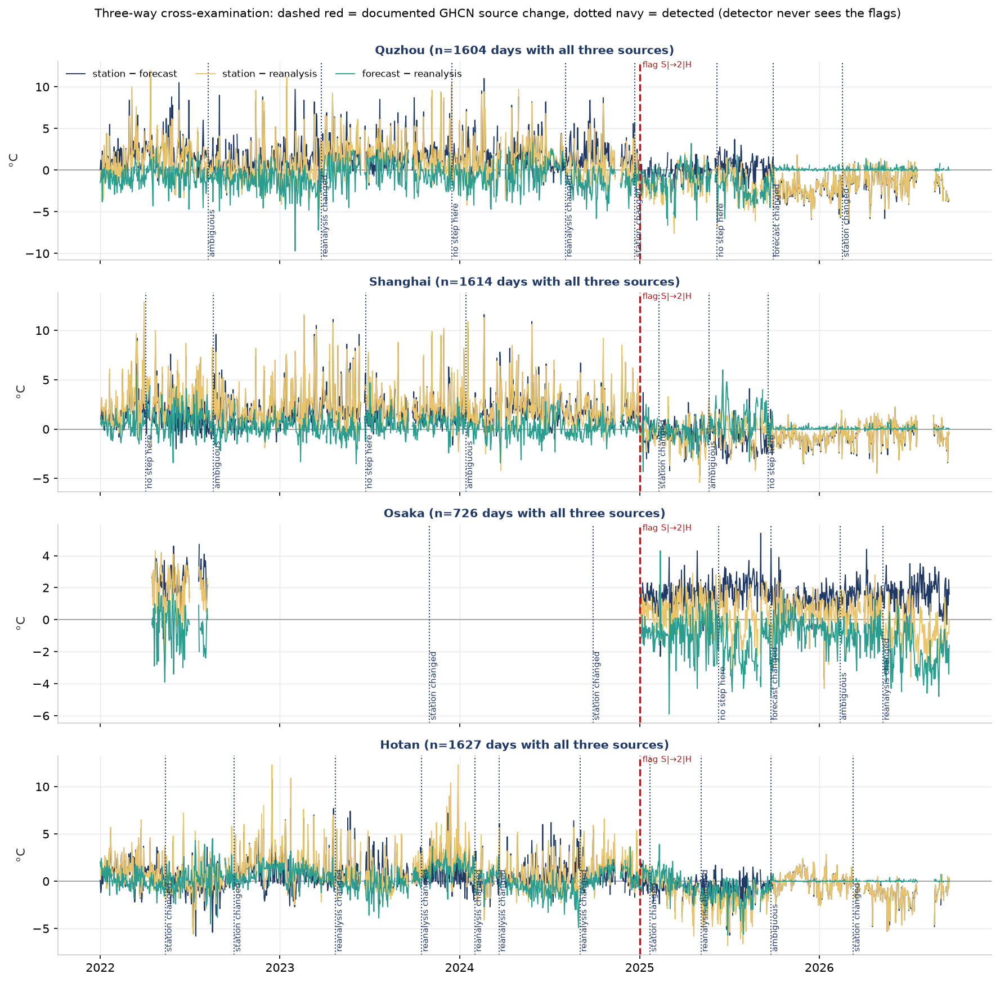

# WeatherAudit

**Track:** AI + Climate · **Team:** solo entry · **Starting point:** our own idea

WeatherAudit audits station-level temperature corrections for local heat planning. A simple rolling bias rule removes most of the measured error; when that bias moves, a three-source check suggests which record to investigate. It is a retrospective prototype, not an operational warning service.

**Start here:** [one-page write-up](WeatherAudit_writeup.pdf) · [executed notebook](WeatherAudit.ipynb) · [historical replay card](weather_report.html). All notebook outputs are saved. This README gives the supporting detail. GitHub displays HTML source for the replay card; download that file and open it in a browser to view the card.

## The problem and intended user

A local climate-service analyst must decide whether a corrected forecast is dependable enough to inform heat advice. A correction can become stale when either the forecast or the observing record changes. We focus on Quzhou, China, with seven additional stations in China, Japan and South Korea to test how much the result varies. We have not measured effects on users, health outcomes or emissions.

## What we built and added

The notebook takes archived model forecasts and quality-screened NOAA station records, returns error comparisons and heat-alert counts, and produces a replay card with a rolling correction and empirical interval. Our contribution is the comparison against simple rules and a three-source attribution check, with published failures and an independent provenance field used for retrospective checking.

## How it works

Temperature training uses earlier dates; the final **306 calendar dates** form the test window, with 254–300 reported days per station. Training counts are 375–1,109. Chinese windows are 2025-11-21 to 2026-09-22; Japanese/Korean windows are 2026-01-05 to 2026-11-06. Missing target readings are excluded. The model is fitted before the split; rolling corrections and lag features may update with earlier test observations only after an assumed eight-day archive delay. This delay is a conservative design assumption, not a verified per-record release timestamp. Early stopping samples only the pre-test training set; the outer evaluation is chronological. These are exploratory retrospective results, not a sealed prospective study.

`HistGradientBoostingRegressor` learns the station-minus-forecast error using forecast variables, season and delayed past errors. We compare it with fixed/monthly offsets, rolling 7/30-day bias and persistence. Differences use 4,000 paired moving-block bootstrap resamples, each block containing seven consecutive **available observations**; gaps can make a block longer than a week. These original intervals are approximate and unadjusted. The supplementary analysis uses calendar-week blocks and Holm adjustment over 16 comparisons. Ten training seeds check stability.

## Results

Daily maximum temperature MAE, in °C, on each station's full temperature test set:

| Station (test days) | Default | Monthly offset | Rolling 30-day | Boosting |
|---|---:|---:|---:|---:|
| Quzhou (254) | 1.86 | 3.00 | 1.20 | 1.31 |
| Shanghai (256) | 0.98 | 1.96 | 0.86 | 0.94 |
| Osaka (300) | 1.52 | 0.68 | 0.68 | 0.65 |
| Hotan (258) | 1.18 | 1.41 | 0.92 | 1.05 |
| Chuncheon (300) | 1.58 | 1.21 | 1.12 | 1.08 |
| Gangneung (299) | 1.25 | 1.14 | 1.02 | 1.03 |
| Pohang (300) | 1.70 | 0.99 | 0.96 | 0.84 |
| Busan (300) | 1.90 | 1.09 | 1.05 | 1.01 |

* The rolling rule improves on the default at all eight stations; each approximate 95% gain interval excludes zero. Boosting also has lower mean error than default at all eight, with seven intervals excluding zero.
* Boosting has lower mean error than the rolling rule at four stations. Only **Osaka and Pohang** have an original, unadjusted positive gain interval excluding zero; **Hotan** is significantly worse, and five comparisons are inconclusive. A confidence interval spanning zero means insufficient evidence of a difference, not proof of equality.
* At Quzhou the monthly offset increases MAE from 1.86 to 3.00 °C, while the rolling rule reduces it to 1.20 °C. Mean station-minus-forecast error changes from +1.17 °C in training to −1.73 °C in testing. This is evidence of instability; the train/test contrast alone does not date or explain the change.
* In the separate **day-ahead Previous Runs** check, raw MAE is **1.13–2.06 °C**, and rolling-corrected MAE is **1.03–1.48 °C**. At Quzhou it is **2.06 → 1.48 °C**. This is the more relevant check for planning tomorrow.

**Required persistence comparison.** Yesterday's observed maximum predicts today's. Each row below scores every method on exactly the same dates with a valid previous-calendar-day reading. This assumes prompt station access, so it is an optimistic reference under our eight-day archive delay; Table 2b also reports an eight-day persistence reference with matching availability.

| Station | Common days | Yesterday MAE | Default | Rolling 30-day | Boosting |
|---|---:|---:|---:|---:|---:|
| Quzhou | 239 | 2.88 | 1.84 | 1.22 | 1.31 |
| Shanghai | 243 | 2.27 | 0.98 | 0.86 | 0.95 |
| Osaka | 299 | 2.04 | 1.53 | 0.68 | 0.65 |
| Hotan | 247 | 2.44 | 1.14 | 0.92 | 1.01 |
| Chuncheon | 299 | 2.73 | 1.58 | 1.12 | 1.08 |
| Gangneung | 297 | 2.74 | 1.25 | 1.02 | 1.02 |
| Pohang | 299 | 2.58 | 1.70 | 0.96 | 0.84 |
| Busan | 299 | 1.94 | 1.90 | 1.05 | 1.01 |

**Decision and uncertainty checks.** A hot day exceeds the station's training 90th percentile. At Osaka, boosting catches 25 of 30 such days versus 9 for the default, with 3 false alerts; Quzhou has only 2 hot days, so local heat-alert effectiveness is unproven. Rolling intervals target 80% and empirically cover **76–81%** across stations, without a distribution-free guarantee under drift. After preserving missing precipitation as missing in lag features, rain Brier score improves over raw probability at **7/8** stations but over the training-frequency baseline at **6/8**; fixed-threshold umbrella costs improve only at Quzhou (610 versus 898 per 1,000 observed test days). Rain samples are just 56–129 days, and thresholds chosen on training predictions can overfit.

## Which record changed

With station S, forecast F and ERA5 E, the identity `S−F = (S−E) − (F−E)` gives a diagnostic pattern: if only S steps, both differences involving S step while F−E stays flat. CUSUM segmentation proposes dates; block permutation and local magnitude/t-like thresholds screen them. Correlated sources or simultaneous changes can defeat attribution. The algebra is exact; attribution is conditional.

The detector does **not** receive provenance flags as input. In a retrospective check of four documented `S| → 2|H` switches on 2025-01-01, it attributes three to the station record within a **±45-day** tolerance: Quzhou 10 days away, Hotan 21, Shanghai 39. Osaka is missed and has only one usable observation in the preceding 150 calendar days. There are no wrong source labels **among those four scored switches**; this is not a detector-wide accuracy or zero-false-positive claim, and development was not independently blinded.

NOAA defines `S` as GSOD, already derived from hourly synoptic reports; `2` is its SSOD version 2 successor, and `H` denotes a maximum/minimum of hourly temperatures. These flags document a **provenance/processing change**. They do not establish that a sensor, observation-day boundary or physical temperature changed.

Positive injected steps of +0.5 °C are found in 3/9 trials and correctly attributed in 1/9; +2 °C in 8/9 and 6/9. Station injections are attributed correctly in only 2/12 trials. The unmodified real-data control windows return **12 unverified events**; without ground truth for every natural change, that count is not an identified false-positive rate.

## Added robustness and detector improvements

The added checks use fixed settings and the same cached data; they are retrospective additions, not a new independent station test set. [ROBUSTNESS.md](ROBUSTNESS.md) reports the complete protocol, matched-date tables and unfavorable outcomes.

* Reporting-lag assumptions of 1, 8, 14, 30 and 60 days preserve lower rolling mean MAE than raw at all eight stations. This tests sensitivity; actual record publication times remain unknown.
* Rebuilding day-ahead maxima at local UTC+9 for Japan/Korea changes raw MAE by at most 0.006 °C and rolling MAE by at most 0.012 °C on identical dates. Whole-day station-label shifts materially worsen error. Local civil days do not establish NOAA observation-day timing.
* Calendar-week resampling and Holm correction across 16 comparisons support rolling gains at seven stations; Shanghai is inconclusive. No boosting gain over rolling retains support; Hotan remains worse. The earlier Osaka/Pohang intervals are explicitly unadjusted.
* Signed injections and known-null simulations now test both directions, three onset dates and autocorrelated background. A conservative detector adds 28-observation dependence blocks, three Bonferroni-screened root searches and stricter local screening. Its full validation and loss of real-switch matches are reported in the supplement.

## Limitations and next steps

Original API calls use UTC+8; the added Previous Runs sensitivity check reaggregates Japan/Korea to local UTC+9. NOAA daily labels can still use other observation windows. These are comparisons with a station record, not a proven harmonization of identical 24-hour measurements. Station gaps, changing reporting protocols and site selection limit generalization. Forecast and reanalysis are dependent model products. A heuristic agreement score and unhomogenized single-station climate trends are context, not calibrated probabilities or climate-change attribution. In Quzhou raw ICON (1.02 °C) outperforms our rolling correction, which makes model selection another useful baseline.

The TimesFM run is retained only as a legacy exploratory result: its long forecast horizon and compressed missing-day history prevent a fair comparison with weather forecasts (`TIMESFM_NOTE.md`). We draw no physics-versus-pattern-learning conclusion from it.

Next, verify actual daily observation windows and publication times, lock settings before testing new stations, evaluate an alarm-gated correction prospectively, and validate actual heat-planning decisions with a local user.

## Reproduce

Keep the notebook, `weatheraudit.py`, `robustness_checks.py` and `cache.zip` in the same directory. Install `requirements.txt`, then run all cells; the script alternative is `python weatheraudit.py`. A clean-directory review run used only the shipped cache, **denied every HTTP request**, and completed in 89.08 seconds with **24 cells, 124 outputs, 10 figures and no errors**. Colab users should upload both Python files and the cache in the Files panel before running. Saved outputs require no execution to view.

`requirements-lock.txt` records the tested package versions; other versions may change fitted model values. `cache_manifest.json` records hashes of all 436 cached files. `results_v4.json` holds the original results; `robustness_results.json` and `detector_improvement_results.json` hold the added checks. Both protocol JSON files record fixed settings. `REPRODUCIBILITY.md` gives the exact release checks. The optional TimesFM experiment has its own dependencies and is not part of this verified run.

## Sources and credits

* NOAA GHCN-Daily observations and flag definitions: https://registry.opendata.aws/noaa-ghcn/ ; https://www.ncei.noaa.gov/pub/data/ghcn/daily/readme.txt . Station IDs: Quzhou CHM00058633, Shanghai CHM00058362, Hotan CHM00051828, Osaka JAM00047772, Chuncheon KSM00047101, Gangneung KSM00047105, Pohang KSM00047138, Busan KSM00047159.
* Open-Meteo Historical Forecast, Previous Runs and ERA5 Archive APIs (CC BY 4.0): https://open-meteo.com/en/docs/historical-forecast-api ; https://open-meteo.com/en/docs/previous-runs-api ; https://open-meteo.com/en/docs/historical-weather-api . The historical forecast archive is stitched from recent runs; it is not a fixed day-ahead forecast.
* Models and libraries: https://scikit-learn.org/ ; https://pandas.pydata.org/ ; https://numpy.org/ ; https://scipy.org/ ; https://matplotlib.org/ ; https://requests.readthedocs.io/ . Interval background: Angelopoulos and Bates, https://arxiv.org/abs/2107.07511 .
* Exploratory TimesFM model: https://huggingface.co/google/timesfm-2.5-200m-pytorch ; https://github.com/google-research/timesfm ; https://pytorch.org/ . Its legacy results are not a controlled benchmark; see `TIMESFM_NOTE.md`.
* AI assistance: Claude (https://claude.ai/) and WorkBuddy (https://www.codebuddy.cn/work/) were used heavily for coding, experiments and drafting. OpenAI Codex (https://openai.com/codex/) performed final code, reproducibility and text review, and assisted with the demo video. The entrant chose the question and directed the work. The video uses synthetic narration and generated graphics/audio, with production credits accompanying the video.

