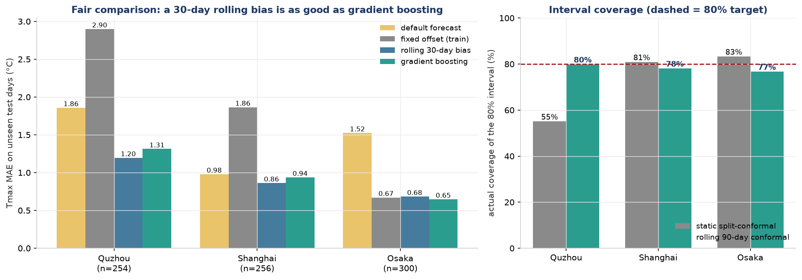

# WeatherAudit: grading weather forecasts against real station thermometers

**Track:** AI + Climate · **Team:** solo entry · **Code:** [`WeatherAudit.ipynb`](WeatherAudit.ipynb), outputs saved · a prototype, not a weather service

## The problem

Weather forecasts are usually checked against other model products on a coarse grid, not against a thermometer. We asked how wrong the forecast daily maximum temperature is at a real weather station, and whether that error can be removed.

Trying to remove it turned up a harder problem. A *static* correction made the forecast **worse**: at Quzhou the forecast ran about 1.2 °C cold during training and 1.7 °C warm during the test window. Something underneath had moved. But when a station, a forecast and a reanalysis disagree, which one changed? That question is what the project ended up being about.

## What we built

A notebook that grades archived forecasts against public weather stations (Quzhou and Shanghai in China, Osaka in Japan), compares six corrections under one no-peeking rule, and then **cross-examines three data sources to identify which one changed.**

## What we added

This is our own idea, not a suggested project.

* **Station truth.** Our first version used ERA5 reanalysis as the truth and the forecast looked almost perfect, because both come from the same kind of model. We switched to station thermometers.
* **A fair baseline.** Gradient boosting is compared with a one-line rule that sees the same information, with a 95% interval on the difference — and it loses.
* **Three-way cross-examination**, below: a cheap way to tell *which* source moved, validated blind.

## How it works

**Data.** Station readings from NOAA GHCN-Daily; archived forecasts, forecasts issued 1–2 days earlier, and ERA5 from Open-Meteo. Only days the station reported are used. The test window is the last 305 calendar days (254–300 station days per city); training is everything before (≈1,100 station days in China, 375 in Osaka).

**Correction model.** A `HistGradientBoostingRegressor` predicts the forecast error from forecast values, season and recent errors; a classifier does the same for rain. Features from past errors use readings at least 8 days old. Baselines: default forecast, fixed and monthly offsets, rolling 7- and 30-day bias. Ranges come from conformal prediction, static and rolling.

**Cross-examination.** Three sources report the same daily maximum: station **S**, forecast **F**, reanalysis **E**. Their differences obey an exact identity, `d_SF = d_SE − d_FE`, so only two are independent. If exactly one source steps, exactly one difference stays flat — and that names it:

| what changed | S−F | S−E | F−E |
|---|---|---|---|
| the station | steps | steps | **flat** |
| the forecast | steps | **flat** | steps |
| the reanalysis | **flat** | steps | steps |

Changepoints come from max-|CUSUM| with binary segmentation, tested by block permutation (7-day blocks, 400 iterations, p ≤ 0.05); a step counts as "moved" at |jump| ≥ 0.5 °C and |t| ≥ 2.0.

## Results

Mean absolute error of daily maximum temperature on the test window, °C:

| Method | Quzhou | Shanghai | Osaka |
|---|---|---|---|
| Default forecast (baseline) | 1.86 | 0.98 | 1.52 |
| Monthly offset learned on training data | 3.00 | 1.96 | 0.68 |
| Rolling 30-day bias (one line of code) | **1.20** | **0.86** | 0.68 |
| Gradient boosting (our model) | 1.31 | 0.94 | **0.65** |
| Gradient boosting, range over 10 random seeds | 1.26–1.39 | 0.91–0.95 | 0.64–0.67 |
| Boosting gain over rolling bias, 95% interval | −0.12 (−0.25, +0.01) | −0.07 (−0.22, +0.05) | +0.04 (0.00, +0.07) |
| 80% range, days covered: static → rolling | 55% → 80% | 81% → 78% | 83% → 77% |

* **The forecast can be corrected**: the rolling rule cuts error by 0.66 °C (Quzhou), 0.84 °C (Osaka), 0.12 °C (Shanghai), all intervals excluding zero.
* **Our model does not beat the one-line rule.** It ties in Quzhou and Shanghai, wins by 0.04 °C in Osaka. We report this as the main machine-learning result.
* **Heat alerts:** of Osaka's 30 hot days the forecast catches 9, the rolling rule 16 (2 false alarms), boosting 25 (3 false alarms).

**The cross-examination, scored blind.** Every GHCN observation carries source and measurement flags. The detector never reads them. All four stations changed their TMAX flags on 2025-01-01, from `S|` to `2|H` — NOAA documents `S` as the daily summary, `2` as its successor feed, `H` as "highest or lowest hourly temperature". So the record stopped being a daily summary and became derived from hourly values. Against that answer key:

| Station | Detected | Days off | Verdict | |
|---|---|---|---|---|
| Quzhou CHM00058633 | 2024-12-22 | 10 | station changed | ✓ |
| Hotan CHM00051828 (2,500 km inland, desert) | 2025-01-22 | 21 | station changed | ✓ |
| Shanghai CHM00058362 | 2025-02-09 | 39 | station changed | ✓ |
| Osaka JAM00047772 | — | — | missed | ✗ |

**3 of 4 correct, no wrong labels.** At Quzhou the step is unambiguous: S−F moved −2.13 °C (t = −4.9) and S−E −1.97 °C (t = −3.7), while F−E stayed flat at +0.16 °C (t = +0.3). Osaka was missed because the station reported only **1 usable day** in the 150 days before the switch (96 days in 2022, 8 in 2023, 3 in 2024) — a data gap, not a failure of the test. The method also separates a *different* event: at Quzhou on 2025-09-29 the verdict is "forecast changed" (S−F −2.48, F−E +1.98, S−E flat), matching a drift we measured separately between the default forecast and ICON.

**Where it fails.**

* **The detector is blind to small steps.** Planting steps of known size on a quiet stretch: 0.5 °C found 3 times in 9 and attributed once; 2 °C found 8 of 9, attributed 6; 3 °C found 9 of 9, attributed 7. Planted *station* steps are weakest — found 8 of 12, attributed only 2, usually "ambiguous".
* **Its false-alarm rate is not zero.** With nothing planted the same windows still return 12 events (Quzhou 4, Shanghai 1, Hotan 7). A verdict is a reason to check a source, not proof.
* **The sources are not fully independent** — forecast and reanalysis are both model output — and the method says *which* source moved, never *why*.
* Four stations, three in China; detections land 10–39 days from the documented switch, not on it.
* On forecasts really issued a day ahead the error is larger (2.06 / 1.13 / 1.74 °C); the rolling rule still helps (1.48 / 1.03 / 1.30 °C). Shanghai has 5 hot days and Quzhou 2, where corrections do not help. Rain is tested on 56–129 days, beats a constant base rate only in Osaka, and does not lower the umbrella cost. In Quzhou raw ICON (1.02 °C) beats everything we did. Quzhou is ~114 km from the author's home, so this is not a doorstep forecast.

## What we'd do next

Run the cross-examination over many stations at once to see how often provenance quietly changes; make the rolling correction the main method and test it 2–7 days ahead; have a correction refuse to fire when the detector says its calibration period is stale; log a thermometer at home for real local truth.

## Sources

* NOAA GHCN-Daily (stations CHM00058633, CHM00058362, JAM00047772, CHM00051828) and its `ghcnd-readme.txt` flag definitions: https://registry.opendata.aws/noaa-ghcn/
* Open-Meteo Historical Forecast, Previous Runs and Archive (ERA5) APIs, CC BY 4.0: https://open-meteo.com/
* Angelopoulos and Bates, *A Gentle Introduction to Conformal Prediction*: https://arxiv.org/abs/2107.07511
* Libraries: pandas, NumPy, SciPy, scikit-learn, matplotlib, requests.
* AI tools: AI coding assistants (Claude and WorkBuddy) were used heavily to write and debug the code, run the experiments and draft this text. The author chose the question and directed the work.

Every number above is printed by the notebook. To reproduce, open `WeatherAudit.ipynb` with `cache.zip` beside it and run all cells (about one minute). Gradient-boosting figures can move by a few hundredths of a degree with a different scikit-learn version; nothing else changes.

